# ISP Billing Platform — showcase

**English** · [Русский](README.ru.md) · [Română](README.ro.md)

A billing system for an internet service provider in Moldova, built from scratch to replace
an ageing WHMCS installation. It handles clients, contracts, services, monthly invoicing,
payments, debt and access limiting, and the paperwork around them, in three languages.

This repository is a **showcase**: screenshots and a description of the project. The source
code is private. Every name, code, address and amount in the screenshots is invented: they
were taken from a throwaway copy of the system filled with demo data.

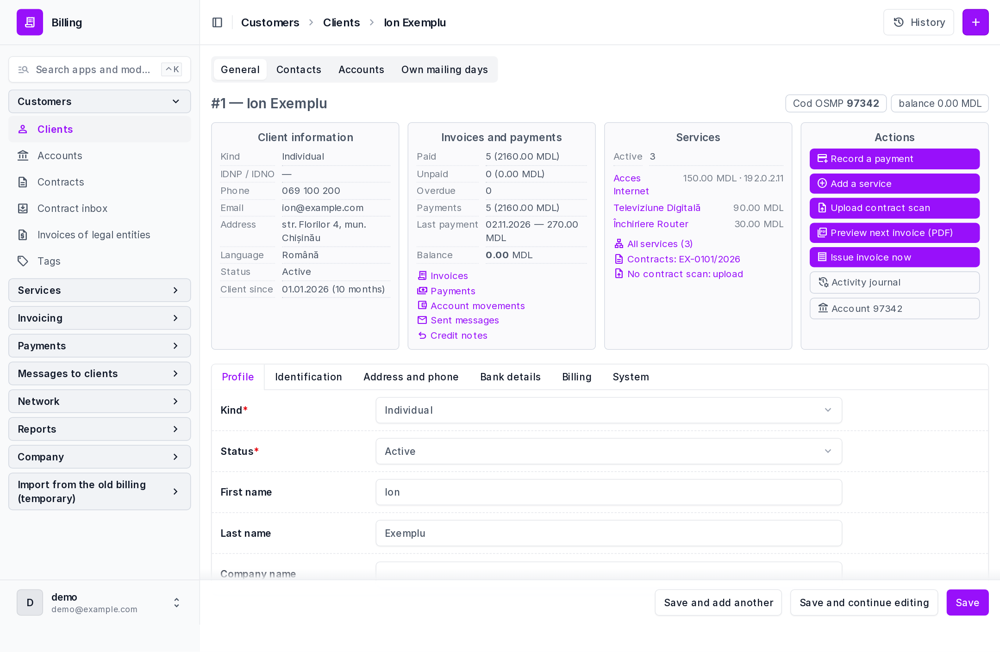

---

## What it does

**Clients and services**
- Individuals and legal entities, contracts, payment codes, contacts, addresses, network
  binding (point of presence, switch, port, IP, MAC).
- A service catalogue (internet, intranet, TV, hosting, colocation, extra IPs, equipment
  rental, one-time and yearly services) with dated price versions: a price change never
  rewrites history.
- Per-service individual prices, internet speeds, and the exact service name printed on the
  invoice.
- Accounts in MDL or EUR; amounts in different currencies are never added up.

**Invoicing**
- Monthly prepaid invoicing on the 1st, with proration by days for every change in the middle
  of a month: connection, pause, debt limit, tariff or price change, closing.
- An append-only ledger: issued invoices are immutable, corrections go through credit notes.
  A payment closes the oldest debt first; the rest becomes an advance.
- Invoice PDFs in the client's language (Romanian or Russian), with a tear-off payment slip.
- A "test before cutover" mode: test documents have their own numbering and can be deleted;
  the monthly run refuses to start while they exist.

**Payments**
- Cash desk, bank, partner networks; duplicate receipt numbers are refused.
- **Bank statements** (OTP Bank `.dbf`): only incoming money is read, the company's own
  payments are skipped, each credit is matched to a client (remembered payer account, IDNO,
  invoice / payment code / contract number in the purpose, company name) and booked after
  one click. Loading the same statement twice adds nothing.

**Documents**
- **Contract inbox**: a batch of scanned contracts is read on the server (text layer or OCR
  in Romanian and Russian), the system suggests whose contract each one is and why, and a
  person confirms. Files get a configurable standard name.
- **Old invoices of legal entities**: the service lines are read from a scan, and the exact
  names and prices are carried into the client's services for the next invoices. The scan
  itself is not kept.

**Messages, reports, audit**
- Email templates in two languages with variables, a mailing schedule with per-client days,
  invoice PDFs attached.
- Reports: income (lei and euro on separate axes), unpaid amounts by age, service statuses,
  new and lost clients.
- An activity journal of every change, view, export and login, with who did it and from where.

**Migration**
- A universal import through a canonical format, with a dedicated WHMCS adapter, a dry run,
  idempotent re-runs that never overwrite what staff changed since, and a review queue for
  problem records. Old duplicate products were merged into one catalogue with every client's
  price and invoice text preserved, proven by comparing all invoices before and after.

---

## Screenshots

| | |
|---|---|
|  Clients | 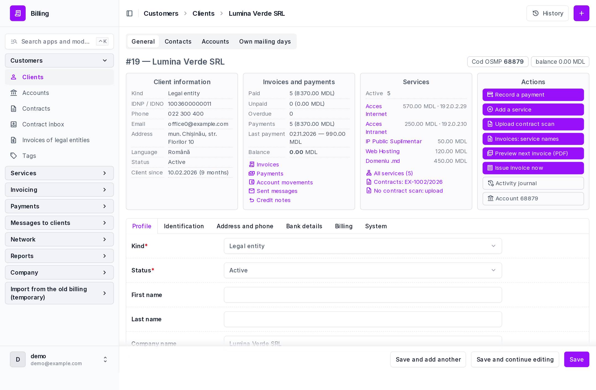 Legal entity card |
| 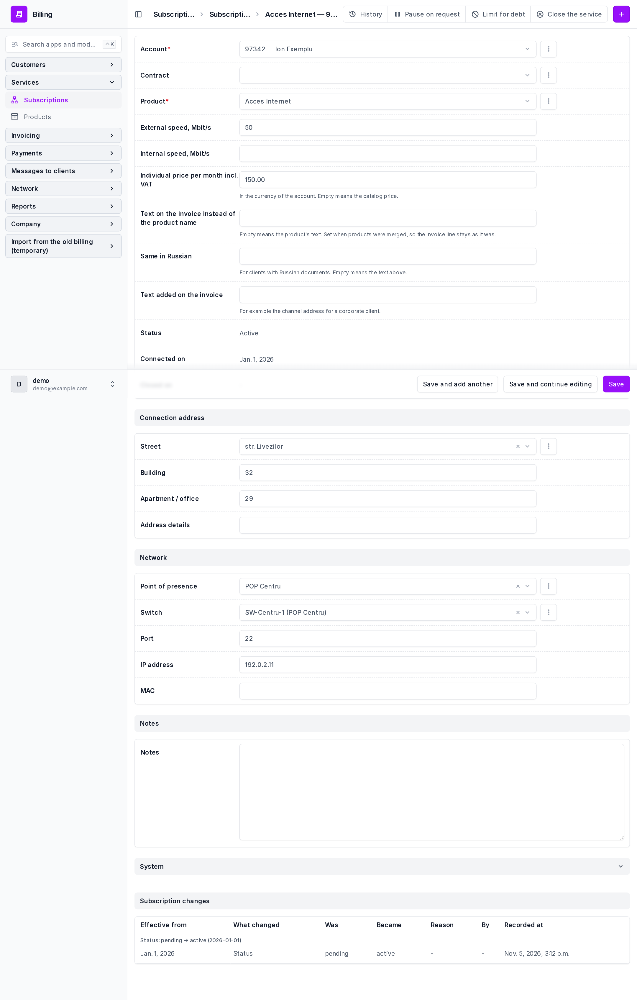 A service with speeds and its history |  Service catalogue |
|  Invoices |  An invoice |
|  Invoice PDF (Romanian) |  Invoice PDF (Russian) |
|  A monthly billing run |  Payments |
|  Bank statement matching | 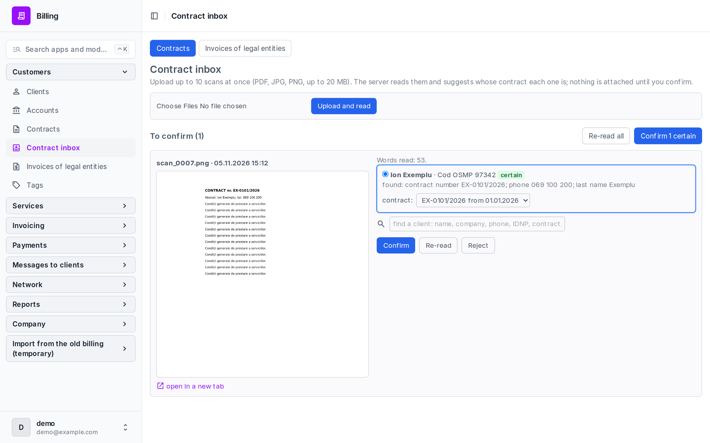 Contract inbox |
| 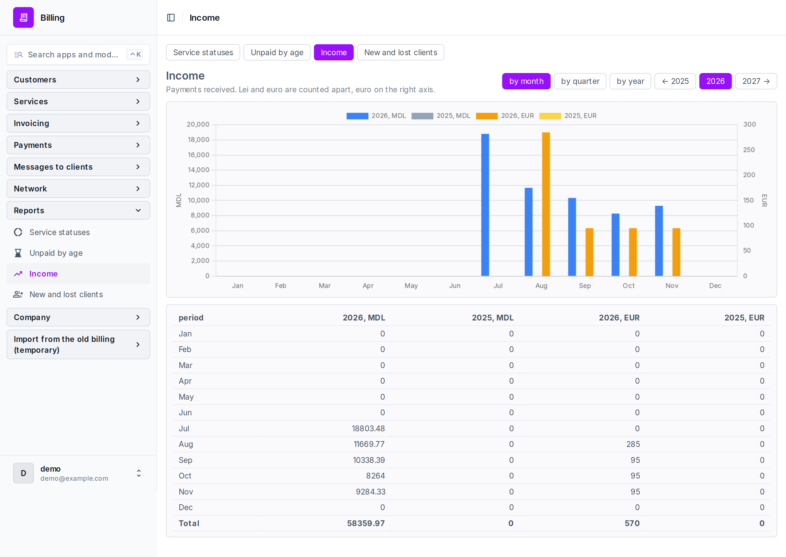 Income report | 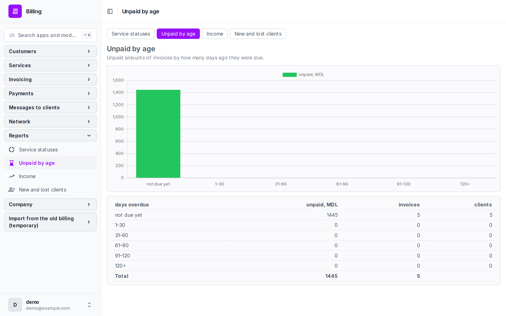 Unpaid by age |
|  Service statuses | 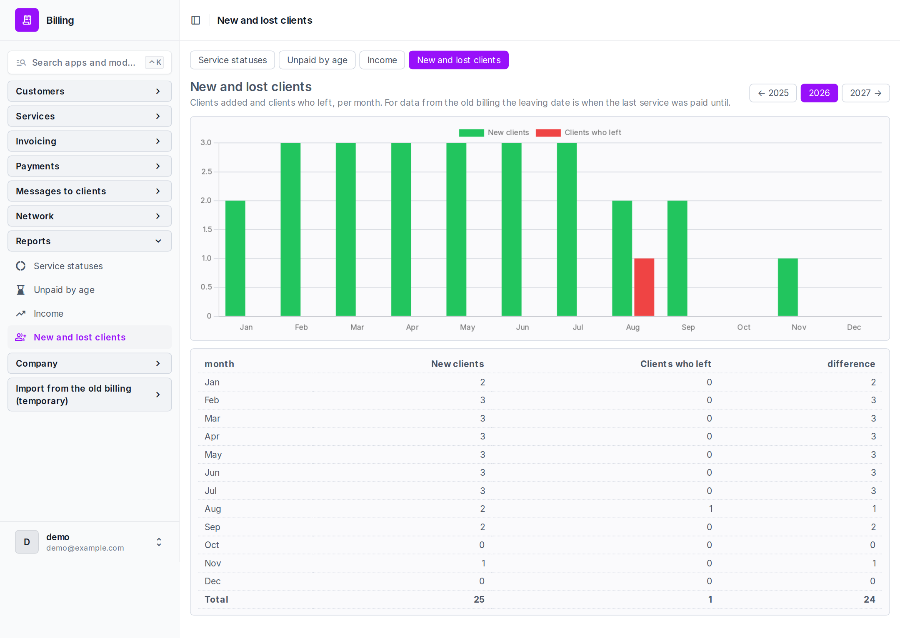 New and lost clients |
|  Message template | 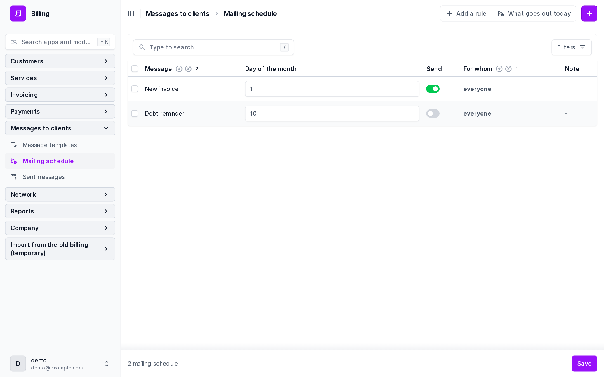 Mailing schedule |
| 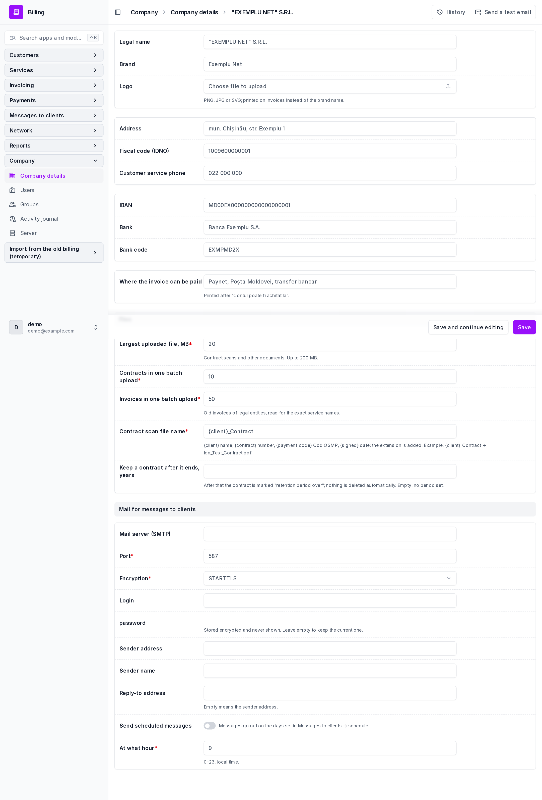 Company details and settings | 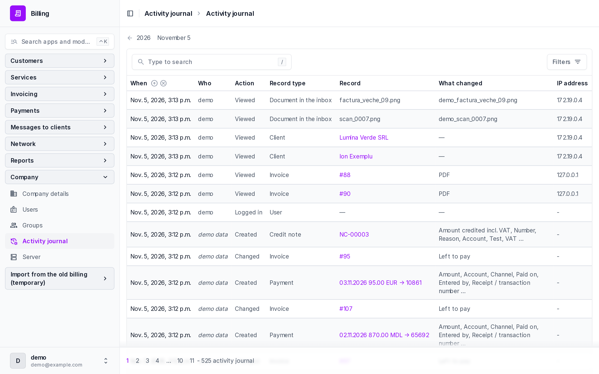 Activity journal |

The interface in Russian and Romanian:

| | |
|---|---|
| 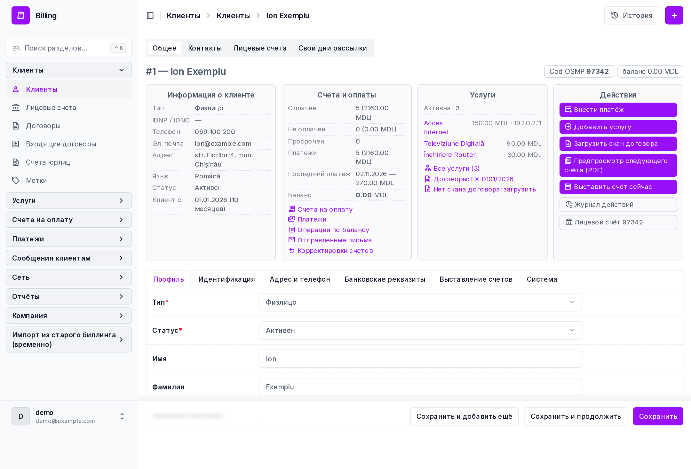 Client card (RU) |  Client card (RO) |
|  Income (RU) |  Bank statement (RO) |

---

## Architecture

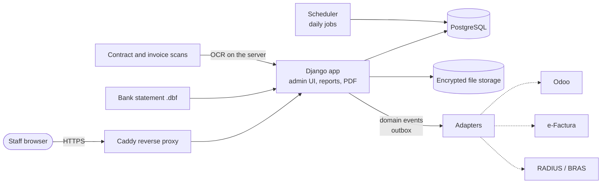

- **Core**: clients, contracts, catalogue, subscriptions with a change timeline, charging and
  proration, invoicing and the ledger, payments. The core knows nothing about external
  systems: it records domain events in an outbox inside the same transaction, and adapters
  deliver them.
- **Money**: decimal amounts, VAT included and extracted per line, rounding half-up, an
  append-only ledger, balances always computed from entries.
- **Policies** (due dates, numbering, limiting delays, upload limits, file name patterns,
  batch sizes) are settings, not code.

## Technology

Python 3.13 · Django 5.2 · PostgreSQL 17 · Docker Compose · Caddy · django-unfold (admin UI) ·
WeasyPrint (PDF) · Tesseract OCR and Poppler · Chart.js · pytest (370+ tests) · ruff ·
gitleaks in a pre-commit hook.

## Security and personal data

Designed with the Moldovan personal data law (Law 195/2024) in mind:

- Uploaded and generated files (contract scans, invoice PDFs) are **encrypted at rest** and
  served only through a view that checks the permission of the record they belong to; every
  opening is recorded.
- Uploads are checked by content, not by name; size limits are a setting.
- Documents are read **on the server** (OCR runs locally); nothing is sent to external
  services.
- Login lockout after repeated wrong passwords, short sessions, an audit trail of logins.
- Firewall limited to the internal network, the app reachable only through the reverse proxy,
  secrets only in environment files, a pre-commit hook that blocks secrets, dumps and
  personal codes.
- OS updates visible in the admin, with an "update" button that only leaves a request for a
  fixed server-side job: the web app can never run commands on the server.

## Planned

- Staff single sign-on with two-factor authentication (Authelia) behind HTTPS.
- e-Factura (the state electronic tax invoice system) for legal entities.
- Odoo integration: clients, services and debt visible next to support tasks.
- Registries of partner payment networks (Paynet, Posta Moldovei).
- RADIUS / BRAS: automatic access limiting for debt and restoring after payment.
- A client self-service cabinet.

---

The screenshots and text in this repository are © the author. The software itself is not
open source.
