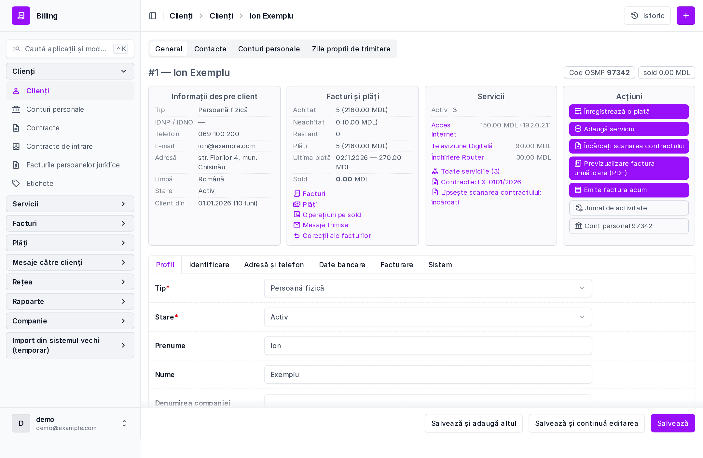
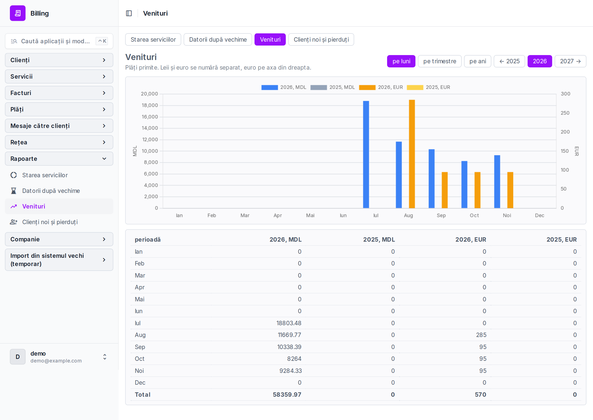
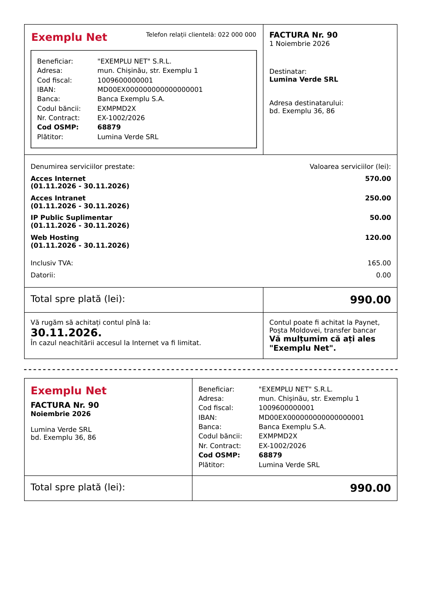
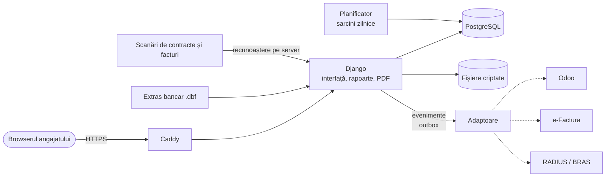

# Billing pentru un furnizor de internet — prezentarea proiectului

[English](README.md) · [Русский](README.ru.md) · **Română**

Un sistem de billing pentru un furnizor de internet din Moldova, scris de la zero în locul unei
instalări WHMCS învechite. Ține evidența clienților, contractelor, serviciilor, facturării
lunare, plăților, datoriilor și limitării accesului, precum și a documentelor din jurul lor, în
trei limbi.

Acest depozit este o **vitrină**: capturi de ecran și descrierea proiectului. Codul sursă este
privat. Toate numele, codurile, adresele și sumele din capturi sunt inventate: au fost făcute
pe o copie temporară a sistemului, umplută cu date demonstrative.

---

## Ce face

**Clienți și servicii**
- Persoane fizice și juridice, contracte, coduri de plată, contacte, adrese, legătura cu
  rețeaua (punct de prezență, switch, port, IP, MAC).
- Un catalog de servicii (internet, intranet, TV, hosting, colocare, IP suplimentar, închiriere
  de echipament, servicii unice și anuale) cu versiuni de preț datate: o schimbare de preț nu
  rescrie niciodată istoricul.
- Prețuri individuale, viteze de internet și denumirea exactă de pe factură — pentru fiecare
  serviciu.
- Conturi în lei sau euro; sumele în valute diferite nu se adună niciodată.

**Facturare**
- Facturi lunare cu plată în avans pe 1, recalculate pe zile la orice schimbare în mijlocul
  lunii: conectare, pauză, limitare pentru datorie, schimbare de tarif sau preț, închidere.
- Un registru de înregistrări în care doar se adaugă: o factură emisă nu se modifică,
  corecțiile se fac prin facturi de corectare. O plată închide întâi cea mai veche datorie,
  restul devine avans.
- PDF-ul facturii în limba clientului (română sau rusă), cu talon de plată detașabil.
- Un mod „verificare înainte de trecere”: documentele de test au numerotare proprie și se pot
  șterge; rularea lunară nu pornește cât timp există.

**Plăți**
- Casă, bancă, rețele partenere; un număr de chitanță repetat nu este acceptat.
- **Extrase bancare** (OTP Bank, `.dbf`): se citesc doar banii intrați, plățile companiei se
  omit, fiecare încasare se potrivește cu un client (contul plătitorului memorat, IDNO,
  numărul facturii / codul de plată / numărul contractului din destinație, denumirea
  companiei) și se înregistrează cu un clic. Reîncărcarea aceluiași extras nu adaugă nimic.

**Documente**
- **Contracte de intrare**: un set de contracte scanate se citește pe server (strat de text
  sau recunoaștere în română și rusă), sistemul sugerează al cui este fiecare contract și de
  ce, iar un angajat confirmă. Fișierele primesc un nume standard după un șablon din setări.
- **Facturile vechi ale persoanelor juridice**: din scanare se citesc rândurile serviciilor,
  iar denumirile și prețurile exacte trec în serviciile clientului pentru facturile
  următoare. Scanarea în sine nu se păstrează.

**Mesaje, rapoarte, jurnal**
- Șabloane de e-mail în două limbi cu variabile, un program de trimitere cu zile proprii
  pentru clienți, PDF-ul facturii atașat.
- Rapoarte: venituri (lei și euro pe axe separate), sume neachitate după vechime, statutul
  serviciilor, clienți noi și plecați.
- Un jurnal al activității: fiecare modificare, vizualizare, export și autentificare — cine și
  de unde.

**Trecerea de la vechiul sistem**
- Un import universal printr-un format unic, un adaptor dedicat pentru WHMCS, rulare de
  probă, rulări repetate care nu suprascriu ce au schimbat angajații și o coadă de înregistrări
  cu probleme. Produsele vechi duplicate au fost unite într-un singur catalog, cu păstrarea
  prețului și a textului de pe factură pentru fiecare client, dovedit prin compararea tuturor
  facturilor înainte și după.

---

## Capturi de ecran

Galeria completă este în [versiunea engleză](README.md#screenshots). Interfața în română:

| | |
|---|---|
|  Extras bancar |  Raportul de venituri |
|  PDF-ul facturii în română |  PDF-ul facturii în rusă |

---

## Arhitectură

- **Nucleul**: clienți, contracte, catalog, servicii cu istoricul schimbărilor, calcul și
  recalculare, facturi și înregistrări, plăți. Nucleul nu știe nimic despre sistemele externe:
  înregistrează evenimentele într-un outbox în aceeași tranzacție, iar adaptoarele le livrează.
- **Banii**: sume zecimale, TVA inclus și extras pe rând, rotunjire la jumătate în sus,
  registru doar cu adăugare, soldul calculat întotdeauna din înregistrări.
- **Regulile** (termene de plată, numerotare, întârzieri de limitare, limite de încărcare,
  șabloane de nume de fișiere, mărimea seturilor) sunt setări, nu cod.

## Tehnologii

Python 3.13 · Django 5.2 · PostgreSQL 17 · Docker Compose · Caddy · django-unfold ·
WeasyPrint (PDF) · Tesseract OCR și Poppler · Chart.js · pytest (peste 370 de teste) · ruff ·
gitleaks în pre-commit.

## Securitate și date cu caracter personal

Gândit ținând cont de legea moldovenească privind datele cu caracter personal (195/2024):

- Fișierele încărcate și generate (scanări de contracte, PDF-uri ale facturilor) sunt
  **păstrate criptat** și se deschid doar după verificarea drepturilor asupra înregistrării de
  care țin; fiecare deschidere se înregistrează.
- Încărcările se verifică după conținut, nu după nume; limitele de mărime sunt în setări.
- Documentele se citesc **pe server** (recunoaștere locală), nu pleacă nicăieri în afară.
- Blocarea autentificării după mai multe parole greșite, sesiuni scurte, jurnalul
  autentificărilor.
- Firewall doar pentru rețeaua internă, aplicația accesibilă doar prin reverse proxy, secretele
  doar în fișiere de mediu, o verificare pre-commit care nu lasă să treacă secrete, dumpuri și
  coduri personale.
- Actualizările sistemului de operare se văd în interfață; butonul „Actualizează” doar lasă o
  cerere pentru o sarcină fixă pe server: aplicația web nu execută niciodată comenzi pe server.

## În plan

- Autentificare unică a angajaților cu doi factori (Authelia) prin HTTPS.
- e-Factura (sistemul de stat al facturilor fiscale electronice) pentru persoanele juridice.
- Integrare cu Odoo: clienții, serviciile și datoria lângă sarcinile de suport.
- Registrele rețelelor partenere de plată (Paynet, Poșta Moldovei).
- RADIUS / BRAS: limitarea automată a accesului pentru datorie și restabilirea după plată.
- Cabinetul personal al clientului.

---

Capturile de ecran și textele din acest depozit © autorul. Programul în sine nu este open source.
