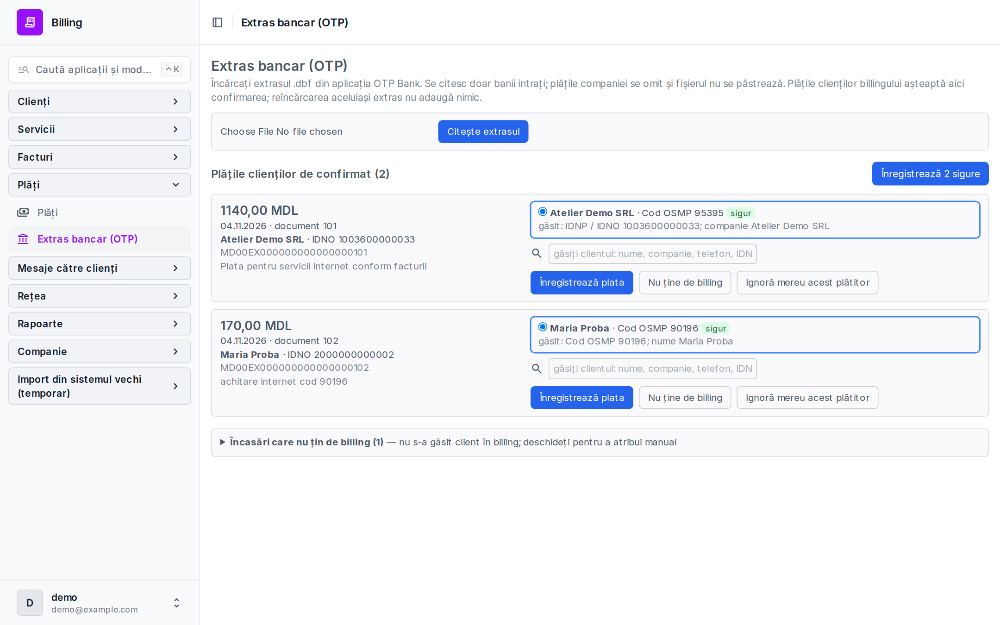
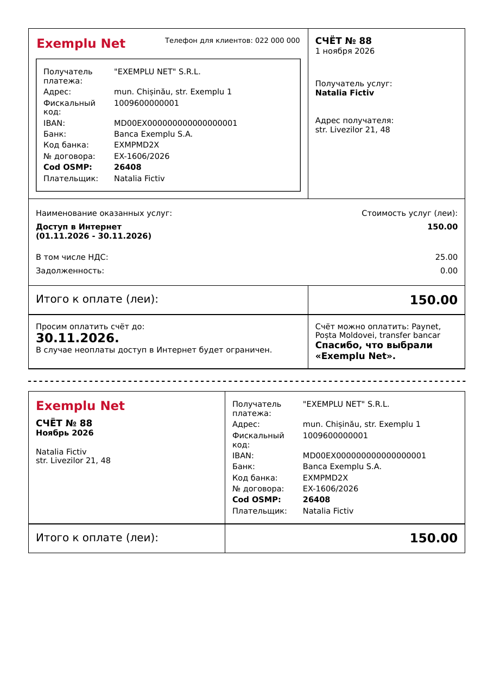
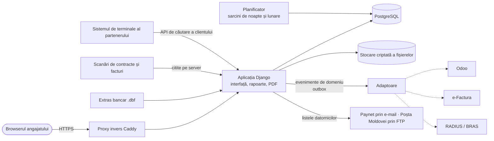

# Billing pentru un furnizor de internet — prezentarea proiectului

[English](README.md) · [Русский](README.ru.md) · **Română**

Un sistem de billing pentru un furnizor de internet din Moldova, scris de la zero în locul unei
instalări WHMCS învechite. Ține evidența clienților, contractelor, serviciilor, facturării
lunare, plăților, datoriilor și limitării accesului, precum și a documentelor din jurul lor, în
trei limbi — și a preluat lucrul de la sistemul vechi cu soldul fiecărui client verificat până la
ultimul leu.

Acest depozit este o **vitrină**: capturi de ecran și descrierea proiectului. Codul sursă este
privat. Toate numele, codurile, adresele și sumele din capturi sunt inventate: au fost făcute
pe o copie temporară a sistemului, umplută cu date demonstrative.

---

## Ce face

**Clienți și servicii**
- Persoane fizice și juridice, mai multe conturi la un client (fiecare cu codul său de plată),
  contracte cu scanări, contacte, adrese, legătura cu rețeaua (punct de prezență, switch, port,
  IP, MAC).
- Un catalog de servicii (internet, intranet, TV, hosting, colocare, IP suplimentar, închiriere
  de echipament, servicii unice și anuale) cu versiuni de preț datate: o schimbare de preț nu
  rescrie niciodată istoricul.
- Prețuri individuale și cantități (8 × IP suplimentar), viteze de internet și denumirea exactă
  de pe factură — pentru fiecare serviciu.
- **Verificări de date în loc de refuzuri**: același IP, MAC, număr de contract sau cod de
  companie la doi clienți, conturi fără contract, numere de contract în afara formatului,
  servicii anuale fără luna plății — totul se salvează, iar coincidențele apar în roșu, cu
  linkuri, până sunt corectate sau confirmate.
- Registrul de stat al companiilor încărcat și comparat cu fișele clienților.
- Conturi în lei sau euro; sumele în valute diferite nu se adună niciodată.

**Facturare**
- Facturare lunară în avans pe 1, cu recalculare pe zile la orice schimbare din mijlocul lunii:
  conectare, pauză, limitare pentru datorie, schimbare de tarif sau preț, închidere.
- **Achitat în avans**: angajatul indică pentru câte luni a plătit clientul înainte — aceste luni
  nu se facturează, la alegere cu o singură factură pe toată perioada; serviciile anuale se
  facturează în luna în care clientul plătește în fiecare an.
- **Persoanele juridice** se facturează prin ciorne: pregătite într-o zi stabilită, trimise de o
  persoană și aprobate de alta înainte de emitere; o factură pe contract.
- **Calcul de probă pentru orice lună**: fiecare factură cu datele, rândurile și totalul, pe
  carduri — iar pentru o lună deja facturată de sistemul vechi, comparată cu acesta client cu
  client.
- Pagina **„Graficul facturării”** pentru managerii de billing: când se emit facturile, când se
  trimit prin e-mail, când pleacă fișierele de plată — fiecare cu comutator și zi, și ce urmează.
- Un registru doar cu adăugări: facturile emise nu se schimbă, corecțiile se fac prin note de
  credit. O plată închide întâi datoria cea mai veche; restul devine avans. O factură anulată se
  vede ca anulată; una greșită poate fi ștearsă împreună cu notele de credit, iar plățile pe ea
  devin din nou libere.
- **Formele facturilor într-un editor vizual** (GrapesJS) cu versiuni; forma clasică reproduce
  factura tipărită veche la milimetru. Facturile sunt în română, mesajele în limba clientului.
- **Tipărire**: facturile unei luni câte două pe o foaie orizontală, generate pe server în fundal
  și deschise în browser printr-un link.

**Plăți**
- Casierie, terminale, bancă, poștă; numerele de chitanță repetate sunt refuzate.
- **Extrase bancare** (OTP Bank, `.dbf`): se citesc doar încasările, plățile proprii ale
  companiei sunt sărite, fiecare încasare este potrivită cu un client (contul plătitorului
  memorat, codul companiei, numărul facturii / codul de plată / numărul contractului din
  destinație, denumirea) și înregistrată dintr-un clic. Același extras încărcat de două ori nu
  adaugă nimic.
- **Fișiere pentru partenerii de plată**: lista cine cât are de plătit, în formatul Excel pe care
  partenerii îl citesc deja — la Paynet prin e-mail și la Poșta Moldovei prin FTP; generate
  lunar, previzualizate înainte de trimitere, cu verificarea conexiunii fără trimitere și un
  jurnal al trimiterilor.
- **API de căutare a clientului** după codul de plată pentru sistemul de terminale al
  partenerului — răspunde exact ca sistemul vechi, acces doar de la adrese stabilite și cu cheie.

**Documente**
- **Contracte primite**: un lot de contracte scanate se citește pe server (strat de text sau OCR
  în română și rusă), sistemul propune al cui este fiecare contract și de ce, iar un om confirmă.
  Fișierele primesc o denumire standard configurabilă.
- **Facturile vechi ale persoanelor juridice**: cumpărătorul, codul companiei, contractul și
  fiecare rând de servicii se citesc din PDF după poziția cuvintelor; clientul este propus și
  verificat cu fișa; rândurile se leagă de serviciile existente doar după denumirea exactă, cele
  noi devin servicii; același fișier nu se preia de două ori. Scanarea nu se păstrează.

**Lucrul de zi cu zi**
- O **pagină principală** ca sumarul sistemului vechi: venituri azi, luna aceasta și anul acesta,
  plăci cu linkuri spre liste (clienți și servicii active, limitate pentru datorie, în așteptarea
  conectării, facturi restante), ce așteaptă pe cine, grafice de plăți, venitul lunar așteptat,
  cele mai vechi facturi neachitate și ultimele plăți.
- Liste în care **fiecare își alege coloanele** (cod companie, cod TVA, bancă, sold… pe lângă cele
  obișnuite), valorile se **copiază dintr-un clic**, iar un clic pe rând deschide înregistrarea.
- Fișa clientului cu file: profil, contacte, conturi, contracte cu scanări și toate facturile cu
  data plății, modul de plată și starea colorată; „creează factură” manual.

**Mesaje, rapoarte, jurnal**
- Șabloane de e-mail în două limbi cu variabile, un program de trimitere cu zile pentru fiecare
  client, PDF-ul facturii atașat.
- Rapoarte: venituri (lei și euro pe axe separate), sume neachitate pe vechime, stările
  serviciilor, clienți noi și pierduți.
- Un jurnal al activității: fiecare schimbare, vizualizare, export și autentificare — cine și de
  unde.

**Migrare**
- Un import universal printr-un format canonic, cu un adaptor dedicat pentru WHMCS, rulare de
  probă, rulări repetate care nu suprascriu ce au schimbat angajații între timp și o coadă de
  înregistrări problematice (corectate și importate sau unite cu o fișă adăugată manual).
- Produsele vechi duplicate au fost unite într-un singur catalog, păstrând prețul și textul de pe
  factură al fiecărui client — dovedit prin compararea tuturor facturilor înainte și după.
- La trecere, soldul fiecărui client a fost comparat independent cu sistemul vechi și egalat cu
  documente proprii; lunile achitate în avans în sistemul vechi au fost preluate.

---

## Capturi de ecran

Galeria completă este în [versiunea engleză](README.md#screenshots). Interfața în română:

| | |
|---|---|
|  Extras bancar |  Raportul de venituri |
|  PDF-ul facturii în română |  PDF-ul facturii (versiunea rusă de început) |

---

## Arhitectura

- **Nucleul**: clienți, contracte, catalog, servicii cu cronologia schimbărilor, calcul și
  recalculare, facturare și registru, plăți. Nucleul nu știe nimic despre sistemele externe:
  înregistrează evenimentele de domeniu într-un outbox în aceeași tranzacție, iar adaptoarele le
  livrează.
- **Banii**: sume zecimale, TVA inclus și extras pe fiecare rând, rotunjire la jumătate în sus,
  registru doar cu adăugări, soldurile calculate mereu din înregistrări.
- **Regulile** (termene de plată, zile de facturare, numerotare, întârzieri de limitare, limite de
  încărcare, șabloane de denumiri, mărimi de loturi) sunt setări, nu cod.
- **Actualizări fără întrerupere**: imaginea nouă se construiește și se migrează cât timp
  funcționează cea veche, proxy-ul ține cererile pe durata comutării, migrațiile doar adaugă cât
  timp lucrează oamenii.

## Tehnologii

Python 3.13 · Django 5.2 · PostgreSQL 17 · Docker Compose · Caddy · django-unfold (interfață) ·
WeasyPrint și pypdf (PDF) · GrapesJS (editor de forme) · Tesseract OCR și Poppler · Chart.js ·
pytest (peste 730 de teste, în paralel) · ruff · gitleaks într-un hook pre-commit.

## Securitate și date personale

Gândit ținând cont de legea moldovenească privind protecția datelor personale (Legea 195/2024):

- Fișierele încărcate și generate (scanări de contracte, PDF-uri de facturi, fișiere de tipărire,
  liste de plată) sunt **păstrate criptat** și oferite doar printr-o verificare a dreptului asupra
  înregistrării de care țin; fiecare deschidere este înregistrată.
- Numele persoanelor fizice pot fi mascate pe facturile tipărite.
- Încărcările se verifică după conținut, nu după nume; limitele de mărime sunt o setare.
- Documentele se citesc **pe server**; nimic nu se trimite la servicii externe.
- Un drept pentru fiecare pagină și buton, roluri predefinite (manager de billing, contabil-șef,
  administrator de rețea) actualizate fără a anula schimbările făcute manual; fiecare vede doar
  ce poate deschide, inclusiv pe pagina principală.
- Blocare după parole greșite repetate, sesiuni scurte, jurnal al autentificărilor.
- Parolele serverului de e-mail, FTP și cheile API se păstrează criptat și nu se mai afișează.
- Firewall limitat la rețeaua internă, aplicația accesibilă doar prin proxy, secretele doar în
  fișiere de mediu, un hook pre-commit care blochează secretele, dump-urile, codurile personale
  și adresele interne.
- Actualizările sistemului de operare sunt vizibile în administrare; butonul „actualizează” doar
  lasă o cerere pentru o sarcină fixă pe server: aplicația web nu poate executa niciodată comenzi
  pe server.

## Planificat

- e-Factura (sistemul de stat al facturilor fiscale electronice) pentru persoanele juridice,
  prin API-ul său.
- Autentificare unică a angajaților cu doi factori (Authelia) prin HTTPS.
- Integrare cu Odoo: clienți, servicii și datorii lângă sarcinile de suport.
- RADIUS / BRAS: limitarea automată a accesului pentru datorie și restabilirea după plată.
- Un cabinet personal al clientului.

---

Capturile de ecran și textul din acest depozit sunt © autorul. Software-ul în sine nu este open
source.
