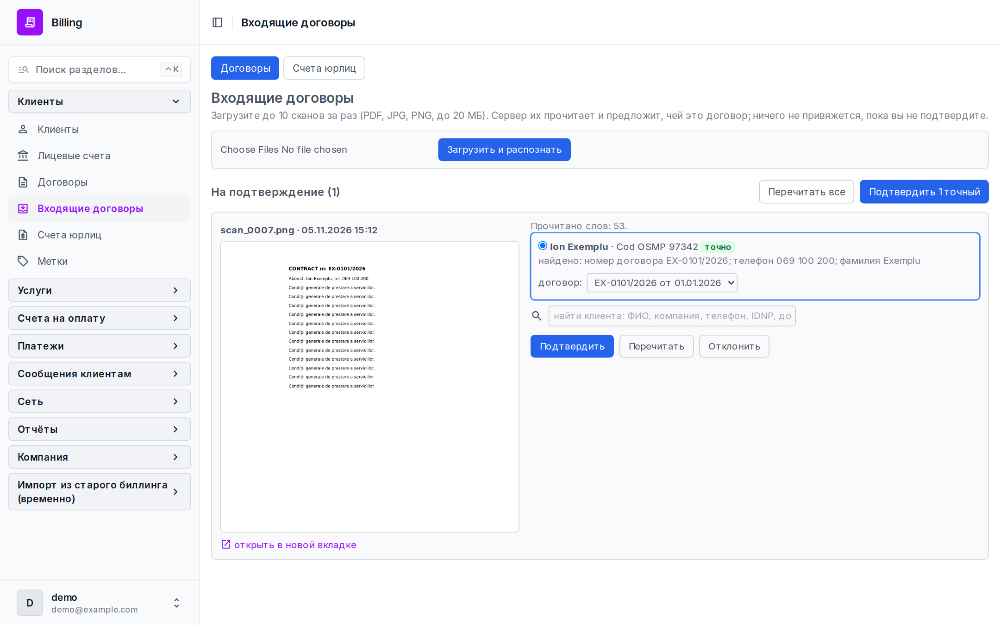
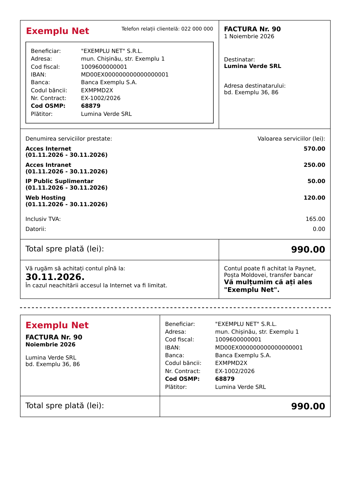
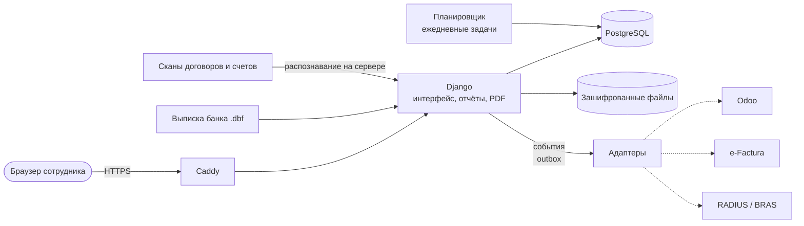

# Биллинг для интернет-провайдера — витрина проекта

[English](README.md) · **Русский** · [Română](README.ro.md)

Система биллинга для интернет-провайдера в Молдове, написанная с нуля на замену устаревшей
установке WHMCS. Она ведёт клиентов, договоры, услуги, ежемесячное выставление счетов,
платежи, долги и ограничение доступа, а также документы вокруг всего этого, на трёх языках.

Этот репозиторий — **витрина**: скриншоты и описание проекта. Исходный код закрыт. Все имена,
коды, адреса и суммы на скриншотах вымышленные: они сняты с временной копии системы,
наполненной демо-данными.

---

## Что умеет

**Клиенты и услуги**
- Физлица и юрлица, договоры, коды оплаты, контакты, адреса, привязка к сети (точка
  присутствия, коммутатор, порт, IP, MAC).
- Каталог услуг (интернет, интранет, ТВ, хостинг, колокация, доп. IP, аренда оборудования,
  разовые и годовые услуги) с версиями цен по датам: изменение цены никогда не переписывает
  историю.
- Индивидуальные цены, скорости интернета и точное название услуги в счёте — у каждой услуги.
- Лицевые счета в леях или евро; суммы в разных валютах никогда не складываются.

**Выставление счетов**
- Ежемесячные счета по предоплате 1-го числа с пересчётом по дням для любого изменения в
  середине месяца: подключение, пауза, ограничение за долг, смена тарифа или цены, закрытие.
- Журнал проводок, в который только добавляют: выставленный счёт не меняется, исправления —
  через корректировки. Платёж закрывает самый старый долг, остаток идёт в аванс.
- PDF счёта на языке клиента (румынский или русский) с отрывным талоном для оплаты.
- Режим «проверка до перехода»: тестовые документы со своей нумерацией, их можно удалить;
  ежемесячный запуск не начнётся, пока они есть.

**Платежи**
- Касса, банк, партнёрские сети; повторный номер квитанции не примется.
- **Банковские выписки** (OTP Bank, `.dbf`): читаются только поступления, платежи самой
  компании пропускаются, каждое поступление сопоставляется с клиентом (запомненный счёт
  плательщика, IDNO, номер счёта / код оплаты / номер договора в назначении, название
  компании) и проводится одним нажатием. Повторная загрузка той же выписки ничего не добавит.

**Документы**
- **Входящие договоры**: пачка сканов договоров читается на сервере (текстовый слой или
  распознавание на румынском и русском), система предлагает, чей это договор и почему, а
  сотрудник подтверждает. Файлы получают стандартное имя по шаблону из настроек.
- **Старые счета юрлиц**: из скана читаются строки услуг, точные названия и цены переносятся
  в услуги клиента для следующих счетов. Сам скан не хранится.

**Сообщения, отчёты, журнал**
- Шаблоны писем на двух языках с переменными, расписание рассылки со своими днями у
  клиентов, PDF счёта во вложении.
- Отчёты: доход (леи и евро на разных осях), неоплаченное по срокам, статусы услуг, новые и
  ушедшие клиенты.
- Журнал действий: каждое изменение, просмотр, выгрузка и вход — кто и откуда.

**Переход со старой системы**
- Универсальный импорт через единый формат, отдельный адаптер для WHMCS, пробный прогон,
  повторный запуск, который не затирает правки сотрудников, и очередь проблемных записей.
  Дубли старых продуктов сведены в один каталог с сохранением цены и текста в счёте у каждого
  клиента; это доказано сравнением всех счетов до и после.

---

## Скриншоты

Полная галерея — в [английской версии](README.md#screenshots). Интерфейс на русском:

| | |
|---|---|
|  Входящие договоры |  Отчёт о доходе |
|  PDF счёта клиенту с русским языком |  PDF счёта на румынском |

---

## Архитектура

- **Ядро**: клиенты, договоры, каталог, услуги с историей изменений, начисления и пересчёт,
  счета и проводки, платежи. Ядро ничего не знает о внешних системах: оно записывает события
  в outbox в той же транзакции, а доставляют их адаптеры.
- **Деньги**: десятичные суммы, НДС включён и выделяется по строке, округление вверх от
  половины, журнал проводок только на добавление, баланс всегда считается по проводкам.
- **Правила** (сроки оплаты, нумерация, задержки ограничения, лимиты загрузок, шаблоны имён
  файлов, размеры пачек) — это настройки, а не код.

## Технологии

Python 3.13 · Django 5.2 · PostgreSQL 17 · Docker Compose · Caddy · django-unfold ·
WeasyPrint (PDF) · Tesseract OCR и Poppler · Chart.js · pytest (370+ тестов) · ruff ·
gitleaks в pre-commit.

## Безопасность и персональные данные

С учётом молдавского закона о персональных данных (195/2024):

- Загруженные и созданные файлы (сканы договоров, PDF счетов) **хранятся зашифрованными** и
  отдаются только через проверку прав на запись, к которой они относятся; каждое открытие
  записывается.
- Загрузки проверяются по содержимому, а не по имени; лимиты размера — в настройках.
- Документы читаются **на сервере** (распознавание локальное), никуда наружу не уходят.
- Блокировка входа после нескольких неверных паролей, короткие сессии, журнал входов.
- Файервол только для внутренней сети, приложение доступно только через reverse proxy,
  секреты только в файлах окружения, pre-commit проверка, которая не пропускает секреты,
  дампы и персональные коды.
- Обновления ОС видны в интерфейсе, кнопка «Обновить» только оставляет заявку для
  фиксированной серверной службы: веб-приложение никогда не выполняет команды на сервере.

## В планах

- Единый вход сотрудников с двухфакторной аутентификацией (Authelia) за HTTPS.
- e-Factura (государственная система электронных налоговых накладных) для юрлиц.
- Интеграция с Odoo: клиенты, услуги и долг рядом с задачами поддержки.
- Реестры партнёрских сетей оплаты (Paynet, Почта Молдовы).
- RADIUS / BRAS: автоматическое ограничение доступа за долг и включение после оплаты.
- Личный кабинет клиента.

---

Скриншоты и тексты этого репозитория © автор. Само программное обеспечение не является
открытым.
