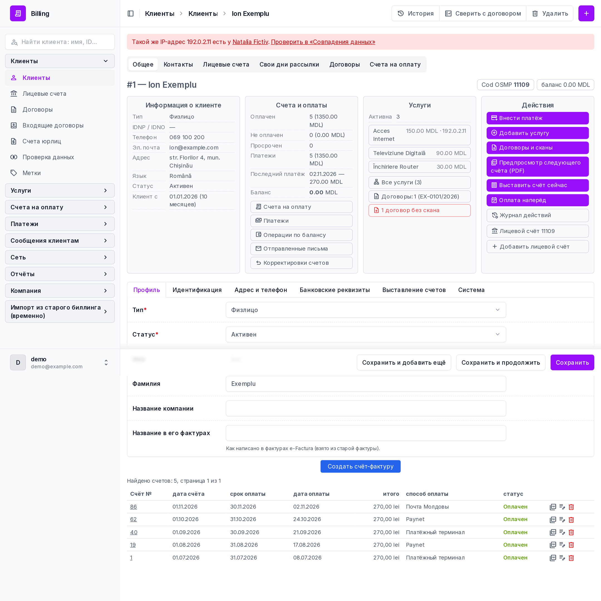
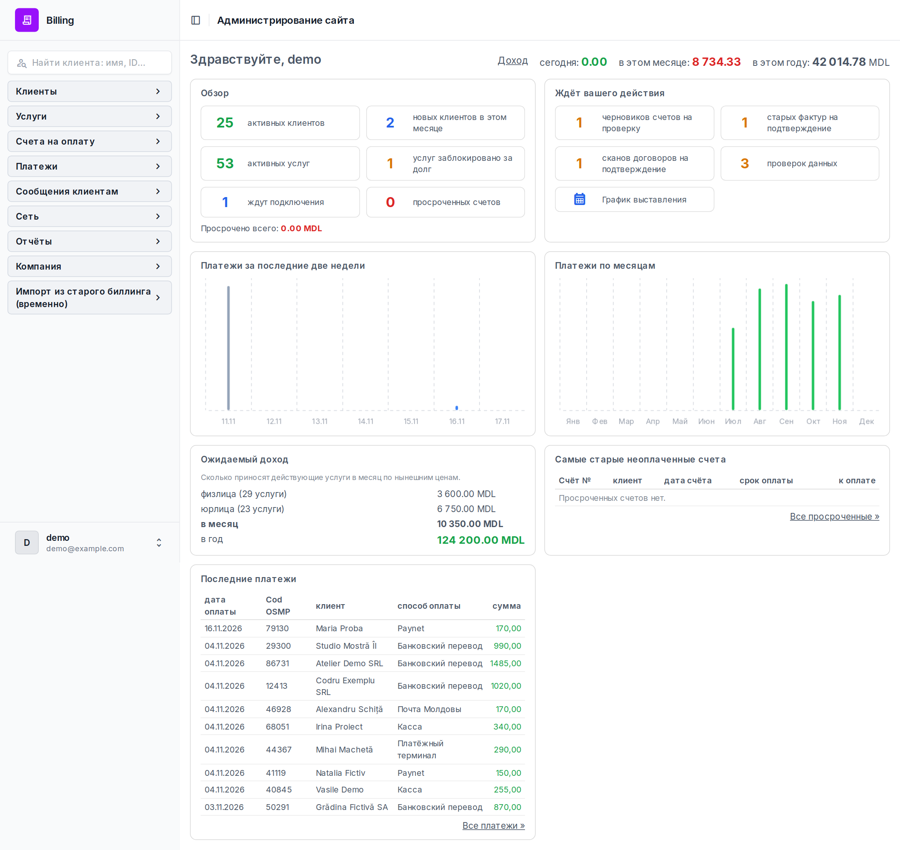
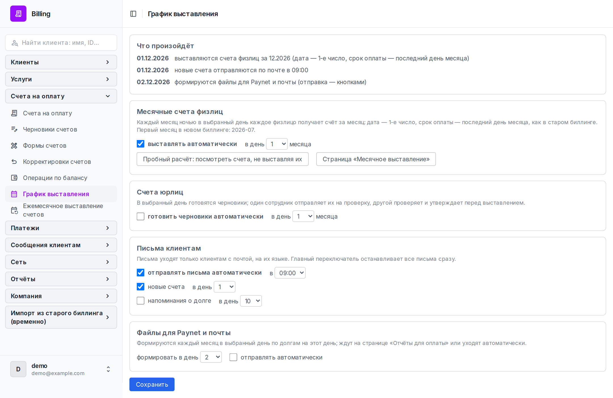
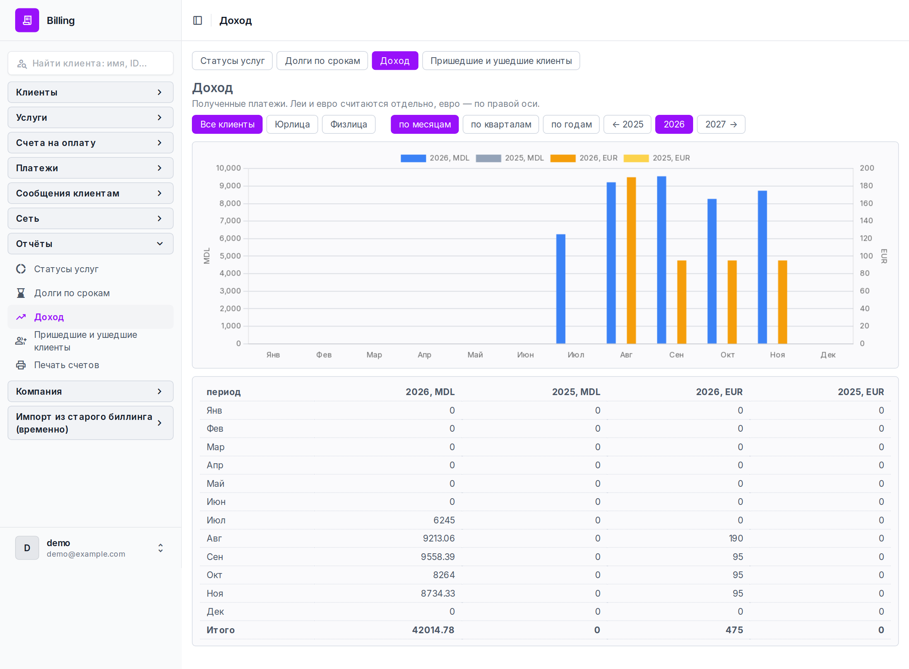
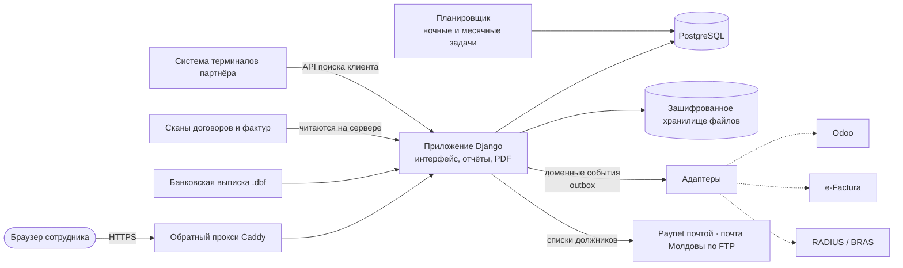

# Биллинг для интернет-провайдера — витрина проекта

[English](README.md) · **Русский** · [Română](README.ro.md)

Система биллинга для интернет-провайдера в Молдове, написанная с нуля на замену устаревшей
установке WHMCS. Она ведёт клиентов, договоры, услуги, ежемесячное выставление счетов,
платежи, долги и ограничение доступа, а также документы вокруг всего этого, на трёх языках — и
приняла дела у старой системы со сверкой баланса каждого клиента до лея.

Этот репозиторий — **витрина**: скриншоты и описание проекта. Исходный код закрыт. Все имена,
коды, адреса и суммы на скриншотах вымышленные: они сняты с временной копии системы,
наполненной демо-данными.

---

## Что умеет

**Клиенты и услуги**
- Физлица и юрлица, несколько лицевых счетов у клиента (у каждого свой код оплаты), договоры со
  сканами, контакты, адреса, привязка к сети (точка присутствия, коммутатор, порт, IP, MAC).
- Каталог услуг (интернет, интранет, ТВ, хостинг, колокация, дополнительные IP, аренда
  оборудования, разовые и годовые услуги) с датированными версиями цен: смена цены никогда не
  переписывает историю.
- Индивидуальные цены и количество у услуги (8 × дополнительный IP), скорости, точное название
  услуги в счёте.
- **Проверки данных вместо запретов**: одинаковый IP, MAC, номер договора или код компании у
  двух клиентов, лицевые счета без договора, номера договоров не по форме, годовые услуги без
  месяца оплаты — всё сохраняется, а совпадения горят красным со ссылками, пока их не исправят
  или не подтвердят.
- Загружен государственный реестр компаний и сверяется с карточками клиентов.
- Лицевые счета в MDL или EUR; суммы в разных валютах никогда не складываются.

**Выставление счетов**
- Ежемесячные авансовые счета 1-го числа с перерасчётом по дням при любом изменении в середине
  месяца: подключение, пауза, ограничение за долг, смена тарифа или цены, закрытие.
- **Оплата наперёд**: сотрудник указывает, за сколько месяцев клиент заплатил вперёд, — эти
  месяцы не выставляются, по желанию одним счётом на весь срок; годовые услуги выставляются в
  тот месяц, когда клиент платит каждый год.
- **Юрлица** — через черновики: готовятся в заданный день, один сотрудник отправляет на
  проверку, другой утверждает, и только тогда выставляется счёт; один счёт на договор.
- **Пробный расчёт любого месяца**: каждый счёт с датами, строками и суммой в карточках, а для
  месяца, который уже выставляла старая система, — сравнение с ней по каждому клиенту.
- Страница **«График выставления»** для биллинг-менеджеров: когда выставляются счета, когда
  уходят по почте, когда отправляются файлы для оплаты — у каждого переключатель и день, и что
  произойдёт дальше.
- Журнал проводок только на добавление: выставленные счета неизменны, исправления — через
  кредит-ноты. Платёж закрывает самый старый долг, остаток становится авансом. Аннулированный
  счёт так и помечается; ошибочный можно удалить вместе с кредит-нотами, а оплаты по нему
  освобождаются.
- **Формы счетов в визуальном редакторе** (GrapesJS) с версиями; классическая форма повторяет
  старый печатный счёт до пункта. Счета на румынском, письма — на языке клиента.
- **Печать**: счета месяца по два на альбомном листе, собираются на сервере в фоне и
  открываются в браузере по ссылке.

**Платежи**
- Касса, терминалы, банк, почта; повторный номер квитанции отклоняется.
- **Банковские выписки** (OTP Bank, `.dbf`): читаются только поступления, собственные платежи
  компании пропускаются, каждое поступление сопоставляется с клиентом (запомненный счёт
  плательщика, код компании, номер счёта / код оплаты / номер договора в назначении,
  название) и проводится одним нажатием. Повторная загрузка той же выписки ничего не добавляет.
- **Файлы для платёжных партнёров**: список, кто сколько должен, в том формате Excel, который
  партнёры уже принимают, — в Paynet по почте и на почту Молдовы по FTP; формируются раз в месяц,
  с предпросмотром перед отправкой, проверкой связи без отправки и журналом отправок.
- **API поиска клиента** по коду оплаты для системы терминалов партнёра — отвечает ровно как
  старая система, доступ только с заданных адресов и с ключом.

**Документы**
- **Входящие договоры**: пачка отсканированных договоров читается на сервере (текстовый слой
  или OCR на румынском и русском), система предлагает, чей это договор и почему, человек
  подтверждает. Файлы получают настраиваемое стандартное имя.
- **Старые фактуры юрлиц**: покупатель, код компании, договор и каждая строка услуг читаются из
  PDF по положению слов; клиент предлагается и сверяется с карточкой; строки привязываются к
  существующим услугам только по точному названию, новые становятся услугами; один и тот же
  файл дважды не берётся. Сам скан не хранится.

**Повседневная работа**
- **Главная страница** как сводка старой системы: доход за сегодня, месяц и год, плитки со
  ссылками на списки (активные клиенты и услуги, заблокированные за долг, ждут подключения,
  просроченные счета), что кого ждёт, графики платежей, ожидаемый доход в месяц, самые старые
  неоплаченные счета и последние платежи.
- Списки, где **каждый выбирает свои колонки** (код компании, код НДС, банк, баланс… сверх
  обычных), значения **копируются по клику**, а клик по строке открывает запись.
- Карточка клиента с вкладками: профиль, контакты, лицевые счета, договоры со сканами и все
  счета с датой оплаты, способом оплаты и цветным статусом; «создать счёт» вручную.

**Сообщения, отчёты, журнал**
- Шаблоны писем на двух языках с переменными, расписание рассылок с днями для отдельных
  клиентов, PDF счёта во вложении.
- Отчёты: доход (леи и евро на разных осях), неоплаченное по срокам, статусы услуг, новые и
  ушедшие клиенты.
- Журнал действий: каждое изменение, просмотр, выгрузка и вход — кто и откуда.

**Перенос данных**
- Универсальный импорт через канонический формат, с отдельным адаптером WHMCS, пробным
  запуском, повторными запусками без перезаписи того, что сотрудники уже изменили, и очередью
  проблемных записей (исправить и перенести или присоединить к карточке, заведённой вручную).
- Старые дубли продуктов объединены в один каталог с сохранением цены и текста счёта каждого
  клиента — это доказано сравнением всех счетов до и после.
- При переходе баланс каждого клиента независимо сверен со старой системой и выровнен
  отдельными документами; месяцы, оплаченные наперёд в старой системе, перенесены.

---

## Скриншоты

Полная галерея — в [английской версии](README.md#screenshots). Интерфейс на русском:

| | |
|---|---|
|  Главная страница |  График выставления |
|  Карточка клиента |  Входящие договоры |
|  Отчёт о доходе |  PDF счёта, классическая форма |

---

## Архитектура

- **Ядро**: клиенты, договоры, каталог, услуги с хронологией изменений, начисления и
  перерасчёт, счета и журнал проводок, платежи. Ядро ничего не знает о внешних системах: оно
  записывает доменные события в outbox в той же транзакции, а адаптеры их доставляют.
- **Деньги**: десятичные суммы, НДС внутри и выделяется построчно, округление половины вверх,
  журнал только на добавление, баланс всегда считается из проводок.
- **Правила** (сроки оплаты, дни выставления, нумерация, задержки ограничения, лимиты загрузки,
  шаблоны имён файлов, размеры пачек) — это настройки, а не код.
- **Выкат без простоя**: новый образ собирается и мигрирует, пока работает старый, прокси
  придерживает запросы на время переключения, миграции при работающих людях только добавляют.

## Технологии

Python 3.13 · Django 5.2 · PostgreSQL 17 · Docker Compose · Caddy · django-unfold (интерфейс) ·
WeasyPrint и pypdf (PDF) · GrapesJS (редактор форм) · Tesseract OCR и Poppler · Chart.js ·
pytest (730+ тестов, параллельно) · ruff · gitleaks в pre-commit.

## Безопасность и персональные данные

С учётом молдавского закона о защите персональных данных (Закон 195/2024):

- Загруженные и созданные файлы (сканы договоров, PDF счетов, файлы для печати, списки для
  оплаты) **хранятся зашифрованными** и отдаются только через проверку прав на запись, к которой
  относятся; каждое открытие записывается.
- Имена физлиц на печатных счетах можно маскировать.
- Загрузки проверяются по содержимому, а не по имени; лимиты размера — настройка.
- Документы читаются **на сервере**; ничего не уходит во внешние сервисы.
- Право на каждую страницу и кнопку, встроенные роли (биллинг-менеджер, главный бухгалтер,
  сетевой администратор) обновляются, не отменяя ручных изменений; каждый видит только то, что
  ему можно открыть, в том числе на главной странице.
- Блокировка после неверных паролей, короткие сессии, журнал входов.
- Пароли почтового сервера, FTP и ключи API хранятся зашифрованными и больше не показываются.
- Firewall только для внутренней сети, приложение доступно только через прокси, секреты только
  в файлах окружения, pre-commit блокирует секреты, дампы, личные коды и внутренние адреса.
- Обновления ОС видны в админке; кнопка «обновить» только оставляет заявку для фиксированной
  задачи на сервере: веб-приложение никогда не выполняет команды на сервере.

## В планах

- e-Factura (государственная система электронных налоговых накладных) для юрлиц через её API.
- Единый вход сотрудников с двухфакторной аутентификацией (Authelia) за HTTPS.
- Интеграция с Odoo: клиенты, услуги и долги рядом с задачами поддержки.
- RADIUS / BRAS: автоматическое ограничение доступа за долг и восстановление после оплаты.
- Личный кабинет клиента.

---

Скриншоты и текст в этом репозитории © автор. Само программное обеспечение не является
открытым.
